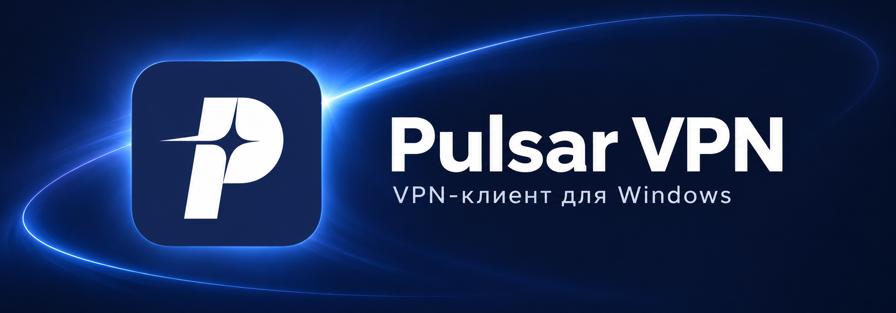
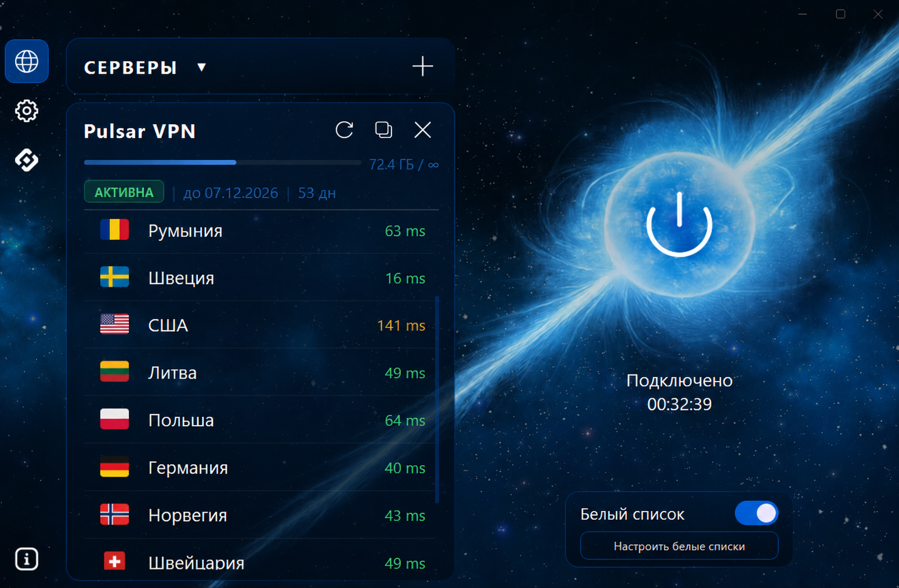
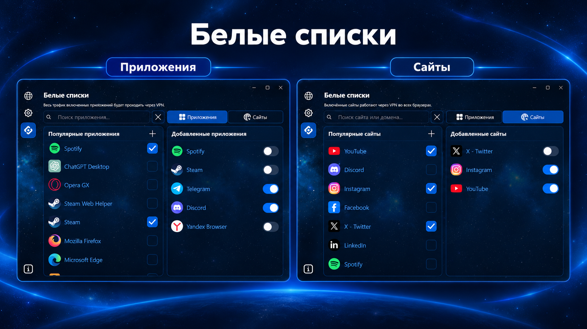
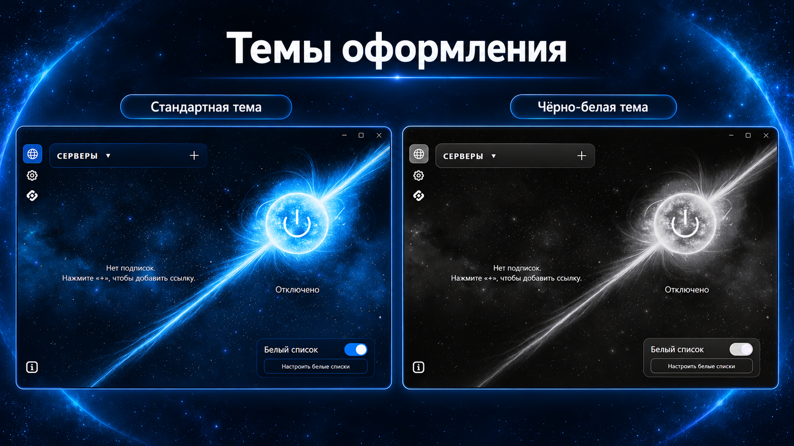

<h1 align="center">Pulsar VPN Client</h1>

  <strong>Ваши подписки. Гибкая маршрутизация. Персональное оформление.</strong> 
  Бесплатный VPN-клиент для Windows на базе sing-box и Xray.

  
  
  

  <a href="https://github.com/oktaygg/Pulsar-VPN-Client/releases/latest"><strong>Скачать для Windows</strong></a>
  &nbsp;·&nbsp;
  <a href="#возможности">Возможности</a>
  &nbsp;·&nbsp;
  <a href="#начало-работы">Начало работы</a>
  &nbsp;·&nbsp;
  <a href="#поддержка">Поддержка</a>

---

Pulsar объединяет управление VPN-подписками, выбор серверов и настройку трафика в одном приложении. Добавьте подписку, выберите сервер и подключитесь. Для приложений и сайтов можно настроить отдельные белые списки, а оформление — изменить под себя.

**Приложение бесплатно.** Для подключения потребуется совместимая ссылка подписки или доступ к собственному серверу. Условия доступа к серверу определяет выбранный вами провайдер.

## Возможности

| Возможность | Что это даёт |
| --- | --- |
| **Несколько подписок** | Добавление по ссылке и переключение между списками серверов. |
| **Выбор сервера** | Задержка в миллисекундах и сохранение выбранного сервера после перезапуска, если он остаётся в подписке. |
| **Белые списки приложений** | Готовый каталог и добавление собственных приложений для работы через VPN. |
| **Белые списки сайтов** | Популярные сайты и собственные домены для работы через VPN в браузерах. |
| **Персональное оформление** | Стандартная и чёрно-белая темы, свой цвет акцента, фон и кнопка в виде пульсара. |
| **Перенос настроек** | Импорт и экспорт тем вместе с пользовательским фоном, а также белых списков приложений и сайтов. |
| **Обновление из приложения** | Проверка новых версий при запуске и установка по кнопке с сохранением пользовательских данных. |
| **Работа в фоне** | Системный трей и настраиваемый запуск вместе с Windows. |

## Начало работы

### Установка

**Системные требования:** Windows 10 или Windows 11, архитектура x64 и доступ в интернет.

1. Откройте [последний релиз](https://github.com/oktaygg/Pulsar-VPN-Client/releases/latest).
2. Скачайте установщик с именем `Pulsar_Setup_<версия>.exe` и запустите его.
3. Завершите установку и откройте Pulsar.

Для системного VPN-туннеля требуются права администратора: подтвердите соответствующий запрос Windows при запуске приложения.

ZIP-архив `Pulsar-<версия>-windows-x64.zip` предназначен для встроенного обновления. Для обычной установки выбирайте EXE.

### Первое подключение

1. На странице серверов нажмите **«+»**.
2. Вставьте ссылку своей подписки и сохраните её.
3. Дождитесь загрузки списка и выберите сервер.
4. Нажмите кнопку подключения.

Выбранный сервер будет восстановлен после следующего запуска, если он по-прежнему доступен. Для подключения нажмите кнопку VPN.

## Белые списки

Настройте, какие приложения и сайты должны использовать VPN:

- **Приложения:** выберите нужные из готового каталога или добавьте своё приложение.
- **Сайты:** включите готовые варианты или добавьте собственный домен.

Включённое приложение направляет свой трафик через VPN. Правила включённых сайтов применяются при работе в браузерах. Перед изменением белых списков отключите VPN.

Для переноса правил откройте **«Настройки» → «Экспортировать белые списки»**. На другом компьютере выберите **«Импортировать белые списки»** и укажите сохранённый файл.

<!-- ИЗОБРАЖЕНИЕ 3: белые списки приложений и сайтов. Можно объединить два скриншота в одну картинку 1600×900. Покажите готовые варианты, поиск и включённые элементы. Сохраните как docs/images/pulsar-whitelists.png; затем раскомментируйте следующую строку. -->
<!--  -->

## Оформление

В настройках доступны стандартная и чёрно-белая темы, собственный цвет акцента и пользовательский фон. Фон и кнопку в виде пульсара можно включать и отключать отдельно.

**Тему можно сохранить целиком.** Экспорт переносит её режим, цвета, настройки фона и кнопки. Если используется собственное изображение, его файл включается в экспорт. После импорта оформление восстанавливается из сохранённой темы.

Для переноса используйте кнопки **«Экспортировать тему»** и **«Импортировать тему»** в настройках.

<!-- ИЗОБРАЖЕНИЕ 4: сравнение стандартной синей и чёрно-белой тем, два окна одинакового размера рядом. Рекомендуемый размер общей картинки — 1600×900. Сохраните как docs/images/pulsar-themes.png; затем раскомментируйте следующую строку. -->
<!--  -->

## Обновления

Pulsar проверяет новые версии при запуске. Проверить обновление вручную можно на странице **«Инфо»**.

1. При появлении новой версии отключите VPN.
2. Нажмите **«Обновить»** в уведомлении или на странице **«Инфо»**.
3. Дождитесь загрузки, установки и перезапуска приложения.

Штатное обновление сохраняет подписки, белые списки и настройки оформления. Уведомление можно закрыть и продолжить пользоваться текущей версией.

При ручной установке поверх существующей версии выберите режим **«Обновить»**, чтобы сохранить пользовательские данные. **Полная переустановка удаляет пользовательские данные.**

Подробности каждого выпуска доступны в [истории релизов](https://github.com/oktaygg/Pulsar-VPN-Client/releases).

## Техническая основа

| Компонент | Поддержка |
| --- | --- |
| **Платформа** | Windows 10 / 11, x64 |
| **Интерфейс** | Python, PyQt6 |
| **Туннельные ядра** | [sing-box](https://github.com/SagerNet/sing-box), [Xray](https://github.com/XTLS/Xray-core) |
| **Режим подключения** | Системный туннель TUN |
| **Протоколы** | VLESS, VMess, Trojan, Shadowsocks |
| **Транспорты** | TCP, WebSocket, gRPC, HTTP, XHTTP |
| **Защищённое соединение** | TLS и REALITY при поддержке сервером |

Совместимость конкретного подключения зависит от протокола и параметров сервера.

## Частые вопросы

<strong>Где взять ссылку подписки?</strong>

У вашего VPN-провайдера или администратора собственного сервера. Добавьте полученную совместимую ссылку на странице серверов через кнопку «+».

<strong>Можно ли установить Pulsar на Android, macOS или Linux?</strong>

Текущая версия предназначена для Windows 10 / 11, x64.

<strong>Зачем нужны права администратора?</strong>

Они нужны для создания системного VPN-туннеля и настройки маршрутизации трафика в Windows.

<strong>Что делать, если подключение не удалось?</strong>

Откройте «Подробнее об ошибке» на странице серверов: там указаны причина, рекомендации и технические подробности. Проверьте доступность интернета и актуальность подписки, затем попробуйте другой сервер. Если проблема повторяется, обратитесь в поддержку.

## Поддержка

Об ошибках и предложениях можно сообщить:

- В [GitHub Issues](https://github.com/oktaygg/Pulsar-VPN-Client/issues).
- В Telegram: [@ggoktay](https://t.me/ggoktay).

Для сообщения об ошибке укажите версию Pulsar, версию Windows и действия, после которых возникла проблема. При необходимости приложите скриншот или технические подробности из окна ошибки. Перед публикацией удалите ссылки подписок и ключи доступа.

## Лицензия

В репозитории размещён текст [GNU General Public License v3.0](LICENSE). Сторонние компоненты распространяются на условиях собственных лицензий.

---

  Разработчик: <a href="https://github.com/oktaygg">oktaygg</a> 
  © 2026 Pulsar VPN Team

